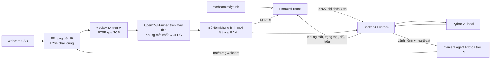
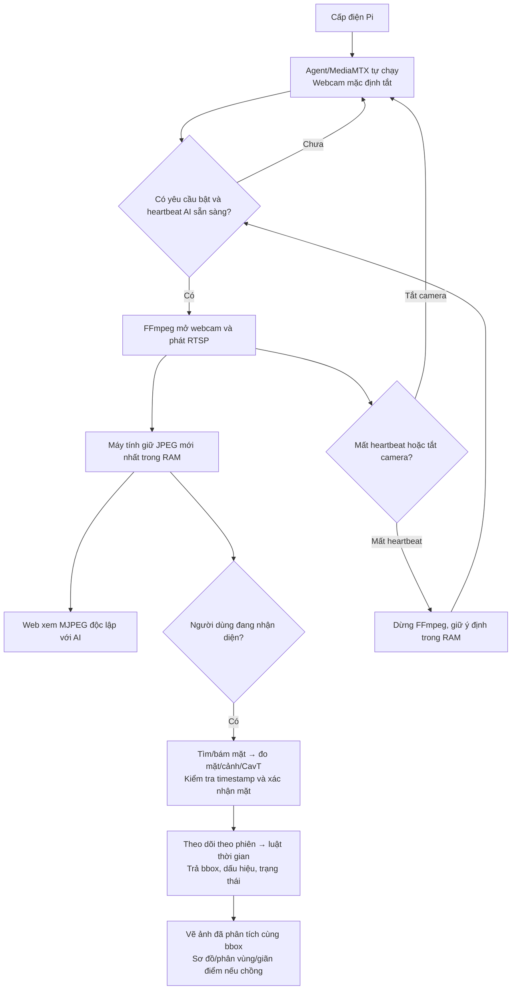

# BÁO CÁO KẾT QUẢ THỰC HIỆN DỰ ÁN

> **Đồng bộ camera AI — 15/11/2026:** bbox thân/mặt/đồ vật chạy bằng luồng bám pixel riêng. Ảnh bất biến và tọa độ mang cùng frame ID, được commit cùng lượt vẽ; không nội suy bbox từ phản hồi AI chậm. AI chỉ cập nhật nhãn/màu. Luồng bám OpenCV chạy process riêng, JPEG cạnh dài 640 px; giữ tối đa 4 gói hình đang xử lý. Đã chạy 5 clip qua frontend/backend thật, gồm trường hợp thêm 1,2 giây trễ AI: ảnh và bbox khớp frame ID, không lỗi API. Nhãn vẫn ghim góc trên bên phải. Độ chính xác đủ 11 biểu hiện **chưa được xác nhận**; sách/laptop còn nhầm, mặt nhỏ/thiếu pose phải là thiếu dữ liệu. Demo công khai chỉ có `backend/tests/test_results/class_3.mp4`; chẩn đoán ở `.qa/behavior_full_audit`. Các số đo/nội suy 80–120 ms bên dưới là lịch sử, không mô tả luồng hiện tại.

> **Cấu hình hiện tại đã chuyển sang AI quan sát hành vi:** bỏ nạp/chấm CavT và nhãn Tập trung; bổ sung phát hiện quay đầu qua lại nhiều lần, tiếp tục theo dõi người khi thiếu khuôn mặt và giảm ngưỡng xác nhận. Các mô tả chấm tập trung/ngưỡng cũ phía dưới là lịch sử của báo cáo. [Cấu hình và luồng đang dùng](QUAN_SAT_HANH_VI_VA_QUAY_DAU.md).

> **Cập nhật 13/11/2026:** có 11 kênh quan sát. Lấy hướng camera làm chuẩn ngay (`AI_CAMERA_YAW_DEG=0`), bỏ chờ thu mẫu cá nhân 10–20 giây. Pose chạy riêng; bổ sung model tư thế gục bàn chỉ khi có đối chiếu bbox người YOLO11s, để xử lý người nằm đầu xuống bàn không có keypoint. Mặc định xác nhận gục qua 1,5 giây mẫu mới; không khẳng định đang ngủ. Nút **Ngưỡng nhận diện** cho phép chỉnh riêng 11 dấu hiệu, lưu theo trình duyệt và áp dụng từ khung tiếp theo, không cần khởi động lại backend. Bbox người/mặt riêng, nét liền; không bật CavT/SAV/SCB. Xem tài liệu liên kết trên để biết nguồn model, ngưỡng và giới hạn.

> **Ổn định bbox:** backend xuất thêm tọa độ hiển thị đã lọc theo ID; tọa độ gốc vẫn dùng để tính hành vi. Nhãn giữ vị trí qua dao động nhỏ, bộ nhớ hiển thị xóa khi mất/đổi đối tượng hoặc nguồn. Đã xuất lại riêng `backend/tests/test_results/class_2.mp4`; báo cáo độ ổn định ở `.qa/class_2-stable/stability-report.json`.

> **Chống nói chuyện nhầm:** mặc định mới 2,5 giây/4 chu kỳ; tăng lọc dao động miệng, không gia hạn cảnh báo từ chu kỳ cũ, chặn cười/ngáp/quay đầu mạnh và mặt nhỏ/mờ. Bảng ngưỡng mỗi chức năng một hàng, mục chỉnh được có `*` đỏ. Pi tiếp tục chỉ truyền video; luật nằm ở backend máy tính, hợp đồng hai nguồn đã kiểm thử, chưa xác minh trực tiếp agent đang cài trên Pi. Xem tài liệu quan sát hiện tại cho giới hạn và cách áp dụng khi đã lưu ngưỡng riêng.

> **Giao diện hiện tại:** bỏ sơ đồ lớp, thay bằng danh sách **Cần chú ý** có ảnh mặt tự chụp từ đúng canvas nhận diện, mã/tên, dấu hiệu, thời điểm và số lần. Không thấy mặt thì ghi rõ hoặc dùng ảnh trước đó có chú thích; không cắt bbox thân làm mặt. Ảnh chỉ giữ trong bộ nhớ phiên, xóa khi tắt/đổi camera hoặc đặt lại; tạm dừng vẫn xem được. Chạy `npm --prefix frontend run test:captures` để kiểm tra giao diện và chụp ảnh bằng nguồn thử, không mở camera thật.

> **Camera di chuyển và người mới:** đã sửa đổi độ phân giải 720p/1080p làm lệch ID ByteTrack, đổi kích thước ảnh bám khi thêm người, bbox người còn bám nền sau kết quả rỗng và lỗi khung làm tạm dừng ngay. Nhận diện tiếp tục quét sau lần phát hiện đầu, thử lại lỗi khung có giới hạn; tạm dừng/tắt bỏ kết quả muộn. Model thật đã qua ảnh thử 1→2 người, dịch bốn hướng, mất hình/nhận lại và tạo phiên sau khi tắt; không mở camera/Pi thật. Hướng chuẩn vẫn theo camera hiện tại, không tự suy ra hướng bảng khi camera di chuyển. Chi tiết và báo cáo trong [tài liệu quan sát hiện tại](QUAN_SAT_HANH_VI_VA_QUAY_DAU.md).

> **Sửa rớt mặt khi chuyển động nhanh:** bỏ ảnh chụp sẵn bị trễ một lượt; dò YuNet trên ảnh hiện tại và tìm lại mặt đã xác minh bằng SCRFD-500M có sẵn. Landmark/profile khớp ROI cũng mở được nhánh phục hồi. Kết quả cũ không ghi đè mặt mới, anchor thân không kéo ngược vị trí mặt vừa đo; chuẩn bị bộ bám thân chuyển ra luồng nền. Model thật đã qua 140/140 khung nói chuyện, nghiêng/dịch nhanh và hai người, không bbox trùng. [Luồng, giới hạn và số đo trước/sau](QUAN_SAT_HANH_VI_VA_QUAY_DAU.md).

> **Đã sửa mất toàn bộ bbox ở lớp đông — 13/11/2026:** lần chạy mới nhất của riêng `class_3.mp4` ở 1× qua frontend/API/model thật có 22/22 phản hồi thấy người, không có phản hồi mất toàn bộ bbox sau lần phát hiện đầu. Có bbox người/mặt riêng và tối đa 15 người có dữ liệu pose; không có lỗi model/API/JavaScript. Video `backend/tests/test_results/class_3_realtime_da_sua_2.mp4` ghi đúng giao diện thực tế, không tua/dừng/chỉnh ngưỡng khi phát. Đã đổi lịch xử lý cảnh trên tám mặt/người để đo mặt trên ảnh đang xử lý, sửa bàn giao template thân và tách model gục bàn khỏi luồng dò người. AI khoảng 1,21 phản hồi/giây, P95 910 ms; MP4 30 FPS chỉ là định dạng ghi hình. Chưa xác nhận độ đúng từng bbox/cảnh báo bằng nhãn đối chứng. Bản lỗi cũ `class_3_realtime.mp4` được giữ để so sánh; xem [số đo và giới hạn](QUAN_SAT_HANH_VI_VA_QUAY_DAU.md).

**STUDENT ATTENTION — HỆ THỐNG HỖ TRỢ QUAN SÁT MỨC ĐỘ THAM GIA HỌC TẬP BẰNG TRÍ TUỆ NHÂN TẠO**

Lĩnh vực: Ứng dụng trí tuệ nhân tạo trong giáo dục.

Đơn vị, nhóm thực hiện, giáo viên hướng dẫn: bổ sung theo thông tin chính thức của nhóm.

Ngày cập nhật kỹ thuật: 11/11/2026. Tài liệu giữ các mục của `docs/Student_Attention_Bao_cao_KHKT_CapNhat.docx`, mô tả đúng mã nguồn hiện tại. Các mục có số liệu phân biệt rõ mô hình thật, camera thật và dữ liệu kiểm thử tổng hợp.

Kiến trúc bbox hiện tại dùng SCRFD-10G và VitTrack pretrained của OpenCV; web phát camera độc lập, ảnh ghép đúng kết quả AI chỉ dùng chụp mặt. Bbox hiển thị theo nhịp trả kết quả và có giới hạn tuổi. Các lượt thử KCF/LK/JSFeat và canvas hiển thị ảnh phân tích trong mục 2.3 là lịch sử trước bản này.
                                   
## MỤC LỤC

1. Lời cảm ơn.
2. Phần tóm tắt nội dung dự án.
3. Vấn đề nghiên cứu dự án.
4. Danh mục các vật liệu cơ bản sử dụng trong dự án.
5. Chương 1. Thiết kế và phương pháp — các mục 1.1 đến 1.6.
6. Chương 2. Chế tạo và kiểm tra sản phẩm — các mục 2.1 đến 2.4.
7. Kết luận.
8. Hướng phát triển của sản phẩm.
9. Tài liệu tham khảo.

## LỜI CẢM ƠN

Nhóm bổ sung lời cảm ơn thầy cô, đơn vị và những người thực tế đã hỗ trợ dự án. Bản tổng quan kỹ thuật này không tự điền tên hoặc xác nhận các hoạt động chưa được cung cấp.

## PHẦN TÓM TẮT NỘI DUNG DỰ ÁN

Student Attention thu hình từ webcam máy tính hoặc webcam USB trên Raspberry Pi 4, xử lý AI tại máy tính và hiển thị video, khung mặt, sơ đồ vị trí cùng sáu dấu hiệu quan sát. Giáo viên chủ động bật camera, bắt đầu/tạm dừng nhận diện và đối chiếu cảnh báo với tình huống lớp học.

Pi chỉ thu và mã hóa video bằng phần cứng. AI chạy trong Python do backend Node.js quản lý. Frontend React hiển thị kết quả; không tải mô hình AI vào điện thoại/trình duyệt. Luồng Pi dùng RTSP nội bộ và được chuyển thành MJPEG cho web. Khung hình chỉ giữ trong RAM, không có chức năng tự lưu video, ảnh khuôn mặt hoặc âm thanh.

Mục tiêu kỹ thuật là hỗ trợ 10–40 mặt trong khung hình, giữ video độc lập với tốc độ suy luận và giữ sơ đồ dễ đọc khi đông người. Bài đo tổng hợp kiểm tra tải và khả năng nối các thành phần; không chứng minh độ chính xác trên một lớp học thật có 40 học sinh.

## VẤN ĐỀ NGHIÊN CỨU DỰ ÁN

Giáo viên khó quan sát đồng thời nhiều học sinh, đặc biệt khi có các biểu hiện ngắn, che khuất hoặc ở xa camera. Dự án nghiên cứu cách thu video liên tục, tìm và bám khuôn mặt, đo dấu hiệu theo thời gian và trình bày thông tin để giáo viên tham khảo.

Các vấn đề kỹ thuật gồm giảm trễ qua Wi-Fi/hotspot; tránh tích hàng khung hình cũ; giảm nhầm vật hoặc tai thành mặt; giữ mã theo dõi ổn định; phân tích hành vi theo bằng chứng mới; và làm rõ các thao tác dừng nhận diện, dừng webcam, tắt hệ điều hành Pi. Khi mất kết nối, hệ thống phải phục hồi có kiểm soát và bỏ kết quả của phiên cũ.

Hệ thống không nhận danh tính sinh trắc học. Mã A, B, …, Z, AA, … chỉ là mã theo phiên; tên do người dùng nhập trong phiên. Sơ đồ là tọa độ trong hình camera, chưa phải bản đồ ghế hoặc khoảng cách thực. Các trạng thái không phải kết luận về suy nghĩ, sức khỏe hoặc mức độ tập trung thực sự của học sinh.

## DANH MỤC CÁC VẬT LIỆU CƠ BẢN SỬ DỤNG TRONG DỰ ÁN

| Thành phần | Vai trò và cấu hình trong bản triển khai |
| --- | --- |
| Raspberry Pi 4, thẻ microSD, nguồn USB-C phù hợp, tản nhiệt | Thiết bị thu hình; chạy camera agent Python và MediaMTX bằng systemd, không chạy desktop/AI |
| Webcam USB | Trên Pi dùng MJPEG 1280×720/25 FPS, lọc còn 15 FPS trước mã hóa để giảm tải |
| Wi-Fi/hotspot/router | Kết nối Pi và máy tính; cần liên lạc nội bộ được và có đủ băng thông cho H264 khoảng 4 Mbps |
| Máy tính x64 | Node.js từ 22.19; Python 3.10/3.11; chạy backend và toàn bộ mô hình. Bộ cài tự tải Python 3.11.14 nếu thiếu bản phù hợp |
| Trình duyệt Chrome/Edge hoặc trình duyệt hỗ trợ API cần thiết | Hiển thị giao diện, cấp quyền webcam máy tính và điều khiển |
| Node/npm, Python, các tệp khóa và mô hình | Dependency được cài bằng `npm run requirement`; trọng số được tải từ nguồn ghim trong manifest và kiểm tra SHA-256 |

Bản Windows x64 được kiểm chứng trên máy phát triển. Nhánh Linux x64 có mã cài, nhưng cần các thư viện hệ điều hành cho OpenCV, như `libGL`/GLib tùy bản phân phối, và chưa được kiểm chứng trên máy Linux riêng. Không có cam kết tốc độ chỉ từ số RAM; CPU, độ phân giải, số mặt và ánh sáng đều ảnh hưởng.

## CHƯƠNG 1. THIẾT KẾ VÀ PHƯƠNG PHÁP

### 1.1. Lập sơ đồ kết nối và kiến trúc hệ thống



Frontend mặc định ở `http://localhost:3000`, backend ở cổng 3001. Proxy `/api` nối frontend đến backend. Python không mở một cổng HTTP riêng; Node trao đổi bằng JSON trên stdin/stdout. Tiến trình đọc RTSP và tiến trình AI riêng giúp video tiếp tục phát khi phân tích hành vi chậm.

### 1.2. Hệ thống thu nhận, phát hiện và theo dõi học sinh

**Thu hình.** Pi dùng FFmpeg đọc webcam USB, chuyển sang H264 bằng `h264_v4l2m2m`, không B-frame, GOP 7, khoảng 4 Mbps. Webcam này công bố đầu vào 25/30 FPS; bản cân bằng thu 25 FPS rồi bỏ bớt khung còn 15 FPS trước chuyển màu/mã hóa. MediaMTX phục vụ luồng RTSP được bảo vệ bằng thông tin riêng. Máy tính đọc RTSP qua TCP, giải mã một luồng FFmpeg và ưu tiên ảnh mới, tạo JPEG chất lượng 80. Tùy chọn FFmpeg được truyền ngay lúc tạo tiến trình để có hiệu lực trên Windows.

Webcam máy tính ưu tiên 1920×1080/30 FPS và không thu âm; trình duyệt có thể thương lượng kích thước thực khác. Webcam Pi giữ 1280×720/15 FPS. Web giữ độ phân giải thu hình, nén JPEG chất lượng 84 và tái sử dụng canvas; gửi tối đa 30 yêu cầu/giây khi không quá 8 track, 15 khi đông hơn. Tốc độ thực phụ thuộc máy/camera. Ảnh kết quả và bbox hiển thị thành một cặp; tạm dừng trả về video trực tiếp. Không phóng ảnh số để tuyên bố tăng chi tiết.

**Tìm mặt.** YuNet và SCRFD-10G tạo ứng viên độc lập rồi hợp nhất. Trọng số `det_10g.onnx` khoảng 16,9 MB lấy từ bản phát hành InsightFace chính thức, ghim nguồn và kiểm SHA-256; thay bản 2.5G trong worker hiện tại. SCRFD-10G từ 0,75 có thể xác nhận sự hiện diện của mặt nghiêng mà không bắt buộc đủ thứ tự landmark chính diện. Các kiểm tra chống nhầm tai/bộ phận đầu vẫn giữ; ứng viên yếu cần thêm mesh/bằng chứng phù hợp. MediaPipe đo hành vi; thiếu số đo mắt/miệng không tự xóa mặt đã đủ bằng chứng detector. Toàn ảnh thường có cạnh tối đa 640; ảnh rất tối còn chi tiết giữ tới 1280 trước tăng sáng. Các tile ảnh gốc luân phiên hỗ trợ mặt nhỏ trên ảnh lớn. Nhánh profile đo mũi/môi/viền mặt không tự xác nhận một khung nghi là tai.

**Bám chuyển động.** Dùng `cv2.TrackerVit_create` của OpenCV với trọng số chính thức khoảng 715 KB. Model cập nhật vị trí/kích thước từng mặt trên mỗi khung. Khi detector mạnh đồng thuận với khung trên ảnh nguồn, giữ model đang bám và làm mới bằng chứng; nạp lại khi lệch, hụt hoặc template cũ từ 1,5 giây. Native score ngưỡng 0,3 xác định cập nhật thành công. Quét nền khoảng 500 ms, khi mất bám yêu cầu lại sau 180 ms. Tile lấy mẫu tới cạnh 640; nhóm 1–8 mặt lớn thăm tile khoảng mỗi 1.250 ms. Mã phiên liên hệ ByteTrack thân người, dùng chung cho webcam trình duyệt và Pi.

Một lần native hụt ngắn giữ riêng bbox cuối tối đa 250 ms từ lần bám thành công, trạng thái `coasting`/`lost`; không đếm đang thấy hoặc tạo cảnh báo mới. Mẫu hụt lặp không gia hạn. Lượt detector âm tính mới bỏ khung ngay. Hết khoảng giữ hoặc tạm dừng/tắt camera/đặt lại thì không tiếp tục vẽ khung đó.

Khi đồng thuận, hình học bbox lấy từ SCRFD-10G để tránh thay đổi khung do đổi detector. Kết quả quét nền được gắn đúng ảnh nguồn; VitTrack đi qua các ảnh trung gian thật tới hiện tại. Bộ đệm tối đa 12 ảnh xử lý/1,5 giây trong RAM, xóa theo phiên. Không nhân bbox mới với scale đã trôi của tracker cũ — phép ghép này từng làm khung nhỏ dần dù detector đã đo lại.

Ứng viên chưa đủ bằng chứng detector mạnh thường cần thêm thân người đã được liên hệ trong dữ liệu cảnh còn mới khi xác minh bằng mesh; kiểm tra này giảm nhận nhầm mặt in nhỏ ở nền. Ngoại lệ: mặt rộng ít nhất 80 px, điểm detector từ 0,85, có mesh đầy đủ khớp đúng vị trí và còn mới, không nghi là bộ phận của đầu bên cạnh, được xác nhận mà không chờ thân người. Mặt có đồng thuận đủ mạnh cũng không chờ luồng cảnh. Hệ thống chưa có phép kiểm tra sống để phân biệt mọi hình mặt trên giấy/màn hình với người thật.

Vị trí và kích thước mặt được ghi tương đối với đúng thân người khi cả hai còn có bằng chứng mới; nếu mặt quay khuất, vùng mặt này có thể được dịch theo thân người với nhãn ước lượng, không thay bằng bbox toàn thân. Dữ liệu thân người quá 1.800 ms không tiếp tục kéo khung. Bám ảnh không có detector xác nhận lại được giới hạn 5 giây; không có cả hai hỗ trợ thì trạng thái hình học hết hạn sau 2 giây từ lần detector cuối. Lượt detector âm tính mới hoặc tracker từ chối mục tiêu không bị bằng chứng cũ ghi đè. Khi mặt được tìm lại trên cùng thân người, vùng bám cũ được loại để tránh hai khung.

Frontend đã bỏ JSFeat, lịch sử ảnh xám, bù vận tốc và lọc kích thước. Web chụp đúng ảnh webcam/MJPEG đang phát, gửi JPEG và hiển thị ảnh đó cùng tọa độ backend lên canvas + SVG. Nguồn Pi trên web dùng API upload cho cặp ảnh/kết quả này; API Pi dùng frame backend mới nhất vẫn phục vụ client không gửi ảnh. Mỗi lượt chỉ có một yêu cầu, giữ khung kết quả hiện hành trong RAM. Cách này loại sai lệch do vẽ bbox cũ lên ảnh video mới nhưng vẫn có độ trễ thu/truyền/suy luận, không cam kết 0 ms hoặc 30 FPS. Ảnh tối/mờ vẫn được tìm/bám; chỉ số chất lượng không tự chặn mặt hoặc số đo hành vi hợp lệ. Detector và tracker cùng dùng tiền xử lý tăng sáng khi cần; nhánh tăng sáng không được tính thành một lần xuất hiện mới.

**Bộ đệm.** Mỗi luồng giữ dữ liệu mới nhất, không nối hàng dài khi AI hoặc trình duyệt chậm. MJPEG xử lý backpressure: chờ gửi xong phần đang ghi rồi lấy khung mới nhất. API upload JPEG vẫn giải mã để xác nhận dữ liệu; JPEG do tiến trình RTSP vừa tạo không bị giải mã lặp thêm ở Node.

Một mặt đã xác nhận có thể giữ riêng khung thêm tối đa 1,2 giây khi MediaPipe bỏ lỡ tạm thời, chỉ khi detector vừa thấy đúng vị trí trong 750 ms và điểm đủ cao. Ứng viên mới vẫn phải xác nhận; số đo hành vi bị thiếu không được tái sử dụng để tạo cảnh báo. Cơ chế này giảm nhấp nháy khi nhiều mặt luân phiên được đo, không gia hạn xác nhận vô hạn.

### 1.3. Hệ thống AI phân tích sáu dấu hiệu tham gia học tập

| Công nghệ | Chức năng thực tế |
| --- | --- |
| YOLO11s + ByteTrack | Phát hiện và theo dõi thân người, hỗ trợ liên hệ mặt/đồ vật |
| YOLO11m | Phát hiện điện thoại, laptop, sách |
| YOLO11n-pose + MediaPipe Hand Landmarker | Cổ tay/bàn tay và bằng chứng tương tác đúng người |
| YuNet + SCRFD-10G; OpenCV VitTrack | Tìm mặt và bám bbox bằng model có sẵn, liên hệ ID thân người |
| MediaPipe Face Landmarker và nhánh profile | EAR, độ mở miệng, blendshape, góc đầu, viền mặt và kiểm tra mũi/môi |
| CavT DAiSEE | Điểm thô từ chuỗi 8 ảnh mặt căn chỉnh 112×112; CPU dùng trọng số Linear INT8 đã chuẩn bị |

Ba YOLO trên CPU dùng ONNX Runtime CPU từ ngày 10/11/2026, giữ đúng trọng số và bộ giải mã letterbox/NMS/cổ tay của adapter OpenCV DNN trước; mô hình GPU dùng nhánh PyTorch nếu môi trường GPU đã được cài phù hợp. Bộ requirement mặc định chuẩn bị CPU, không tự nhận là đã cài CUDA. CavT được nạp từ checkpoint tác giả, không thay bằng mạng ngẫu nhiên; điểm CavT chưa được coi là xác suất hoặc ngưỡng tự động đổi màu vì cần hiệu chuẩn trên dữ liệu lớp thật.

| Dấu hiệu | Bằng chứng và điều kiện thời gian chính |
| --- | --- |
| Nhắm mắt kéo dài | EAR/blink, ít nhất 1,8 giây; loại chớp mắt ngắn |
| Cầm điện thoại | Đồ vật và tay/cổ tay được liên hệ đúng người, ít nhất 0,8 giây |
| Cúi đầu | Pitch vào ngưỡng 22°, giữ đến 20°, ít nhất 2 giây; xét ngữ cảnh sách/vở để tránh cảnh báo riêng tư thế đọc/làm bài |
| Có thể ngáp | Độ mở miệng/jawOpen và dạng miệng, ít nhất 1 giây |
| Có thể nói chuyện kéo dài | Chuyển động miệng lặp lại ít nhất 3 chu kỳ trong cửa sổ 5 giây và kéo dài từ 3 giây; không yêu cầu quay đầu |
| Tương tác laptop | Tay trong vùng tương tác laptop ước lượng, ít nhất 1,5 giây; đã xác nhận thì đỏ |

Số đo mặt thường hết hiệu lực sau 2 giây; đồ vật sau 5 giây. Kết quả có timestamp trùng không làm tăng thời lượng. Mặt dưới ngưỡng khoảng 48 px không đủ điều kiện kết luận mắt/miệng. Thiếu dữ liệu của một dấu hiệu không được biến thành bằng chứng khẳng định dấu hiệu đó.

Các dấu hiệu đã xác nhận hiện đỏ “Cần chú ý”. Theo lựa chọn mới của người dùng ngày 12/11/2026, riêng cúi đầu khi có tương tác sách/vở được xác nhận theo thời gian sẽ được diễn giải bằng ngữ cảnh đọc/làm bài, không tự tạo cảnh báo đỏ từ tư thế này. Trạng thái xanh vẫn cần bằng chứng mặt phù hợp và ổn định; sách không vô hiệu cảnh báo điện thoại hoặc dấu hiệu khác. Mỗi cảnh báo được giữ ít nhất 5 giây từ lần xác nhận mới nhất. `signals` vẫn thể hiện trạng thái hiện tại; `alerts` giữ sự kiện với timestamp, hạn hiển thị và cờ `held`. Khi hành vi không còn xác nhận, giao diện ghi “Vừa ghi nhận: …”; mẫu lặp không gia hạn. Tắt camera hoặc đặt lại phiên xóa cảnh báo. Khi mất mặt nhưng còn liên hệ thân người mới và rõ ràng, có thể hiển thị vùng mặt ước lượng với trạng thái `lost`. Khi chỉ còn `predicted`, không vẽ bbox lên video; vị trí cuối/cảnh báo cũ chỉ giữ trên sơ đồ tới hạn, không đếm là đang thấy mặt và không gán cho người mới bước vào cùng vị trí. Màu đỏ vẫn yêu cầu giáo viên đối chiếu ngữ cảnh.

### 1.4. Hệ thống điều khiển, giao tiếp và hiển thị

| Điều khiển | Hành vi |
| --- | --- |
| Dropdown nguồn | Pi và “Webcam máy tính” luôn có trạng thái; tên/trạng thái cùng một hàng, mặc định chọn Pi. Quét camera khả dụng một lần lúc vào trang; các nguồn khác thêm theo deviceId thực. Tín hiệu cắm/rút chỉ nhắc cập nhật; bấm “Làm mới danh sách” để quét lại. Khi cần quyền, lấy danh sách rồi giải phóng luồng dò; không bật AI hoặc đổi nguồn |
| Bật/Tắt camera | Mở nguồn hình; tắt Pi camera phải dừng FFmpeg và giải phóng thiết bị USB |
| Bắt đầu/Tạm dừng nhận diện | Tạm dừng xóa ngay bbox và điểm sơ đồ, hủy hiệu lực kết quả đang về; video tiếp tục phát |
| Đặt lại sơ đồ | Tạo lại trạng thái/mã trong phiên; bỏ kết quả đang về của phiên cũ |
| Phóng to/thu nhỏ, công tắc sơ đồ | Đổi cách hiển thị, giữ nguồn video và các điều khiển; chữ Phóng to/Thu nhỏ luôn hiện cạnh biểu tượng |
| Tắt Raspberry Pi | Có xác nhận, tắt hệ điều hành; nguồn USB-C vẫn còn điện, bật lại bằng rút/cắm nguồn. Không dùng thao tác này trong lượt kiểm thử cuối |

Khung mặt dùng Motion + SVG, viền chữ nhật liền và nhãn nền tối. Motion chỉ chuyển độ đậm, không nội suy vị trí/kích thước. Khung và sơ đồ dùng cùng tọa độ backend trên ảnh kết quả tương ứng. Khi VitTrack còn bám ảnh, nhãn “Đang bám mặt” không thay số đo hành vi. Khi chỉ còn thân người mới, vùng mặt ước lượng có nhãn “Bám theo người”, trạng thái `lost`, không đếm là đang thấy mặt. Khi không còn hỗ trợ mặt/thân người, không vẽ bbox lên camera; cảnh báo đã xác nhận vẫn giữ riêng trên sơ đồ tới hạn 5 giây. Tạm dừng nhận diện, tắt camera, đặt lại hoặc đổi nguồn xóa bbox và ảnh kết quả, bỏ phản hồi cũ. Sơ đồ có bốn vùng theo ảnh, tối đa 40 điểm với kích thước thích ứng. Điểm chồng được giãn tới ô trống gần vị trí gốc và có nhãn “giãn điểm”; các vùng này chưa phải hàng ghế hoặc độ sâu vật lý.

Bổ sung ngày 12/11/2026 cho USB camera trực tiếp: API trả `tracks` (mặt, mã A/B…) và `objects` (đồ vật, mã O1/O2…) riêng. `FaceOverlay` chỉ vẽ mặt, `ObjectOverlay` chỉ vẽ đồ vật. Điện thoại/sách/laptop có bbox và template VitTrack riêng, dùng cùng mô hình bám ảnh như mặt; vẫn vẽ khi chưa có mặt/tay/chủ sở hữu. Nhãn ghi “Chưa rõ tương tác” khi chưa có đủ bằng chứng tay, không tự tạo cảnh báo cầm điện thoại. YOLO chậm được khởi tạo trên đúng ảnh nguồn và đưa qua các ảnh lấy mẫu tới ảnh hiện tại; bbox đồ vật không giữ nguyên theo lượt quét cảnh cũ. Mất tín hiệu bám, detector mới phủ định, đổi kích thước ảnh hoặc quá 5 giây thiếu xác nhận thì bỏ bbox. Pause/reset/tắt camera/đổi nguồn xóa cả hai lớp. Dấu bản worker: `v4-independent-vittrack`. Đối chiếu báo cáo và kiểm chứng mô hình thật qua luồng upload USB tại [Đối chiếu sáu biểu hiện](../DOI_CHIEU_SAU_BIEU_HIEN.md).

Màu xanh lá: **Tập trung**. Màu vàng: **AI đang quan sát khuôn mặt**. Màu đỏ: **Cần chú ý**. Thông tin là dấu hiệu tham khảo cho giáo viên. Giao diện sáng có responsive, điện thoại dùng các biểu tượng kèm nhãn ngắn quanh dropdown trên cùng một hàng điều khiển.

Backend ghi nhật ký dạng `giờ | mức | thành phần | sự kiện`. Các sự kiện gồm khởi động/AI sẵn sàng, Pi kết nối/mất kết nối/phục hồi, webcam đang mở/đang phát/đã giải phóng, mở/đóng video web, bắt đầu/tạm dừng/kết thúc phiên, xung đột HTTP 409 và lỗi cổng đang dùng. Heartbeat thành công không in log liên tục. Lỗi lặp được hạn chế tần suất; thư viện native chỉ in chi tiết khi `AI_DEBUG=1`. Thông tin RTSP/token được che khi ghi log.

### 1.5. Nguồn cung cấp và kết nối thiết bị

Khi cấp nguồn, Pi tự kết nối Wi-Fi đã lưu và chạy hai dịch vụ agent/MediaMTX bằng systemd. Camera mặc định tắt ở mỗi lần khởi động hệ điều hành. Khởi động lại riêng dịch vụ giữ lựa chọn camera trong `/run`, nhưng không ghi ý định này xuống thẻ nhớ.

Backend gửi heartbeat khoảng mỗi 2 giây, kèm trạng thái AI. Sau hơn 10 giây không có heartbeat phù hợp, agent dừng webcam; giữ ý định bật trong RAM để mở lại khi kết nối/AI phục hồi. Lệnh tắt camera xóa ý định bật, nên webcam không tự bật lại sau đó. Lệnh tắt Pi chỉ gửi khi đang kết nối, không xếp hàng để thực hiện muộn.

Pi giữ root và boot chỉ đọc, lớp ghi overlay, trạng thái và log hoạt động trong RAM, không dùng swap trên thẻ. Cơ chế này giảm ghi và giảm rủi ro do rút nguồn, không bảo đảm tuyệt đối trước lỗi phần cứng/thẻ nhớ. Cập nhật bền vững dùng công cụ triển khai qua `overlayroot-chroot`, có sao lưu trước thay đổi. Lượt kiểm thử cuối không thử cắt nguồn và không reboot/tắt Pi.

Hotspot đôi khi không phân giải tên `.local`. `PI_HOST_FALLBACK` là địa chỉ IPv4 dự phòng đã xác minh, chỉ nằm trong cấu hình backend; khi DHCP đổi phải cập nhật địa chỉ này. Một lần HTTP lỗi sẽ bỏ cache địa chỉ để thử lại. Không đưa token, mật khẩu SSH hay URL RTSP có thông tin đăng nhập vào frontend hoặc GitHub.

### 1.6. Lược đồ giải thuật



## CHƯƠNG 2. CHẾ TẠO VÀ KIỂM TRA SẢN PHẨM

### 2.1. Nối các linh kiện và triển khai hệ thống

1. Gắn webcam USB, thẻ nhớ đã cấu hình, tản nhiệt và nguồn cho Pi; lưu Wi-Fi theo hướng dẫn triển khai bền vững.
2. Cài agent, MediaMTX và systemd trên Pi theo `Raspberry_pi_4/README.md`. Mã cũ giữ webcam phải được dừng/vô hiệu hóa để tránh hai tiến trình tranh thiết bị.
3. Trên máy tính, cài Node.js 22.19 trở lên, clone mã nguồn rồi chạy `npm run requirement` hoặc `requirement.cmd` trên Windows. Không cần cài Python bằng tay khi bộ cài tải được bản riêng.
4. Bộ cài tạo Python `.venv`, cài thư viện Node/Python theo khóa, tải/xác minh model, tạo `.env` mẫu nếu thiếu và build hai ứng dụng. Nó giữ cấu hình đã có và cài thư viện vào vùng tạm trước khi thay thế; các bản thư viện/build trước nằm trong `.runtime/previous` để khôi phục khi cần.
5. Chạy `npm start` tại thư mục gốc: một terminal cho web và backend. Mở `http://localhost:3000`; Ctrl+C dừng cả hai và thu hồi tiến trình con, không gửi lệnh poweroff Pi.

```powershell
# Sau khi clone, tại thư mục gốc:
npm run requirement
npm start

# Kiểm tra môi trường đã cài:
npm run requirement -- --check
```

Lần cài đầu cần Internet, vài GB tải/đĩa và thời gian theo đường truyền; các lần sau dùng model local. Node.js là điều kiện để chạy lệnh npm. Không đưa `node_modules`, `.venv`, model, `.runtime` hoặc `.env` lên Git; các tệp khóa, manifest và script phải có trong repo. Thông tin riêng của Pi cần được người quản lý cung cấp vào `backend/.env`, hoặc được sinh qua `Raspberry_pi_4/deploy.py`. Clone công khai không thể tự biết token của Pi đang có; webcam máy tính vẫn dùng được khi chưa cấu hình Pi.

### 2.2. Viết các chương trình điều khiển và xử lý AI

| Vị trí mã | Trách nhiệm |
| --- | --- |
| `frontend/src/lib/session.ts` | Vòng đời nguồn hình, nhận diện, hủy kết quả cũ, phục hồi Pi và sự kiện vận hành |
| `frontend/src/components/ObservationView.tsx`, `FaceOverlay.tsx` | Video, khung Motion/SVG, sơ đồ và thao tác giáo viên |
| `frontend/src/lib/map-layout.ts` | Kích thước điểm thích ứng, tọa độ theo ảnh, tách điểm bị chồng |
| `frontend/src/lib/backend-api.ts` | Chụp ảnh webcam/MJPEG, gửi JPEG và vẽ đúng ảnh đó cùng kết quả; không bám hoặc lọc scale trên web |
| `backend/src/index.ts`, `app.ts` | HTTP, readiness, API phiên và kết thúc hệ thống |
| `backend/src/pi-controller.ts`, `pi-source.ts` | Heartbeat/lệnh Pi, quản lý reader, khung mới nhất và MJPEG |
| `backend/src/logger.ts` | Log có thời gian/mức/thành phần, che bí mật, giảm lặp, lọc thư viện |
| `backend/src/tracker.ts`, `attention.ts`, `facial-behavior.ts` | Mã theo phiên và tổng hợp sáu dấu hiệu theo thời gian |
| `backend/ai/pi_stream.py` | Đọc RTSP, giải mã và chuyển JPEG giữa các tiến trình |
| `backend/ai/geometry.py`, `scrfd.py`, `face_validation.py` | Tìm, kiểm tra chéo và bám mặt; công bố ứng viên đã được xác minh |
| `backend/ai/visual_tracking.py` | Native OpenCV VitTrack với model có sẵn theo từng ID; liên hệ vùng mặt với thân người |
| `backend/ai/perception.py`, `profile_landmarks.py`, `cavt.py` | Đo mặt, tay, cảnh, profile và chuỗi ảnh CavT |
| `backend/ai/onnx_yolo.py`, `opencv_yolo.py` | Chạy YOLO bằng ONNX Runtime CPU và dùng chung bộ giải mã letterbox/NMS/cổ tay |
| `Raspberry_pi_4/agent.py`, `systemd/`, `deploy.py` | Điều khiển webcam, an toàn heartbeat, tự chạy và cài bền vững |
| `scripts/requirement.mjs`, `runtime.mjs`, `build.mjs`, `start.mjs`, `web.mjs` | Cài môi trường, build và chạy/dừng hai ứng dụng từ thư mục gốc |

Mã giả xử lý một khung:

```text
nhận khung mới nhất → kiểm tra ảnh và phiên hiện hành
tìm/bám tối đa 40 mặt → gửi snapshot mới nhất sang luồng đo mặt và luồng cảnh
lấy các số đo đã hoàn tất → loại ứng viên chưa xác minh hoặc số đo quá hạn
ghép mã theo phiên → cập nhật các bộ đếm bằng timestamp mới
trả tọa độ mặt và đồ vật liên quan, ngữ cảnh sách/vở, sáu dấu hiệu, màu, lý do và thông số xử lý
```

Mã giả hiển thị và kết thúc:

```text
bỏ phản hồi của phiên/luồng cũ → vẽ đúng ảnh đã phân tích cùng bbox của ảnh đó
đổi tọa độ về kích thước vùng video/sơ đồ → giãn điểm nếu có va chạm
tạm dừng nhận diện: ngừng gửi ảnh, bỏ kết quả về muộn, xóa bbox/điểm, giữ video
tắt camera: hủy phiên/luồng, giải phóng webcam; Pi không còn ý định bật
dừng ứng dụng: đóng HTTP, reader và AI; Pi vẫn bật và chờ lần dùng sau
```

### 2.3. Nạp dữ liệu, mô hình và kiểm tra

Model gốc được khóa nguồn, số byte và SHA-256 tại `backend/ai/models.json`. Các model ONNX và CavT suy luận dẫn xuất có manifest kiểm tra riêng. Bộ cài kiểm tra lại trước khi dùng, không yêu cầu đưa trọng số nhiều GB lên GitHub. SCRFD dùng trọng số nghiên cứu phi thương mại từ InsightFace; các điều kiện của YOLO, MediaPipe, CavT và thư viện khác được ghi tại `THIRD_PARTY_NOTICES.md`.

<!-- FINAL_MEASUREMENTS -->
**Tăng nhịp và giữ bbox qua lần hụt ngắn (11/11/2026):** quét nền ổn định cách khoảng 500 ms, VitTrack vẫn bám từng khung; tile lấy mẫu tới cạnh 640 và thăm thưa hơn khi ít mặt lớn. Khi detector mạnh đồng thuận, giữ model/template đang bám thay vì nạp lại và replay không cần thiết. JPEG upload chất lượng 84, tái sử dụng canvas; giới hạn gửi 30/15 lượt mỗi giây cho nhóm nhỏ/đông hơn. Một native miss giữ riêng bbox cuối tối đa 250 ms, trạng thái `coasting`/`lost`; không đếm đang thấy, không tạo cue mới và không tự gia hạn. Detector âm tính mới bỏ khung ngay.

Bài geometry-only trên ảnh công khai hai mặt 1080p, hai lượt 5 giây mỗi bản trước–sau–sau–trước, tăng trung bình khoảng 18,38 → 20,54 lượt/giây (+11,8%). Đây không phải đo FPS USB/web hoặc đầy đủ sáu hành vi; ứng dụng chính có thể cùng dùng CPU. 94 frontend, 139 backend, 83 Python AI và TypeScript/build đạt. Model thật với JPEG 84 giữ đủ hai mặt 96/96 phản hồi, video chính diện/nghiêng 256/256, bài gần/xa và khung nền sai đạt. Chrome xác nhận giữ hình chữ nhật qua lần hụt ngắn, xóa khi dừng và giữ cảnh báo 5 giây. Bằng chứng `.qa/geometry-fps-comparison.json`, `.qa/fps-continuity-verification.json`, `.qa/face-overlay-verification.json`. Bản backend có dấu `v4 short-miss continuity`, cần khởi động lại để nạp mã mới. Không mở/lưu ảnh từ webcam USB của người dùng.

**Bản SCRFD-10G/VitTrack ban đầu (10/11/2026):** sử dụng trọng số chính thức đã kiểm SHA-256 và native tracker OpenCV, thống nhất hình học bbox SCRFD, bỏ phép nhân scale tích lũy khi ghép quét nền. Tracker xử lý các ảnh trung gian thật trong bộ đệm RAM giới hạn. Web dùng Motion + SVG, khung chữ nhật liền trên đúng ảnh đã phân tích; đã bỏ JSFeat và các bộ lọc scale/bù vận tốc tự viết.

Video công khai chính diện/nghiêng, bản gốc và thêm dịch chuyển/roll/scale, giữ cùng ID trong 256/256 phản hồi qua upload/Pi API. Fixture hai người giữ đủ hai mặt trong 96/96 phản hồi; người mới xuất hiện khoảng 559–794 ms ở bốn bài cùng phiên. Bài dịch nhanh có sai lệch tâm lớn nhất 6,67/8,67 px qua hai API; zoom 0,82–1,28 có IoU tối thiểu khoảng 0,730/0,755 so với vùng mặt đánh dấu độc lập. Đây là ảnh/video công khai, API Pi dùng JPEG trong RAM; chưa phải webcam Pi thật. Ảnh sáng hệ số 0,1 và blur sigma 6 giữ đủ hai mặt; blur sigma 20 chỉ còn một. Ảnh đen/nhiễu tối không tạo người.

85 frontend, 138 backend, 81 Python AI, TypeScript/build và kiểm tra môi trường đạt. Chrome với AI thật đã thử tạm dừng/tiếp tục/reset/tắt camera, desktop/mobile; các bài ghép ảnh/bbox cho webcam và MJPEG Pi giả lập đạt khi cố ý thêm 220 ms HTTP. Sáu kênh dữ liệu, CavT và cảnh báo đỏ 5 giây được kiểm tra lại. Ảnh hiển thị vẫn bao gồm độ trễ thu/truyền/suy luận; P95 phản hồi sau khởi tạo ở fixture hai người khoảng 83–104 ms. Không cam kết 0 ms hoặc giữ mặt khi quay hoàn toàn ra sau. Chưa đo lại tải đầy đủ 40 người cho bản này; các bảng tải bên dưới giữ kết quả bản cũ.

Bằng chứng `.qa/pretrained-upgrade-verification.json`, `.qa/pose-verification.json`, `.qa/tracking-motion.json`, `.qa/face-recall-verification.json`, `.qa/lowlight-verification.json`, `.qa/model-verification.json`, `.qa/ghost-verification.json`; chi tiết và nguồn model tại `docs/AI_KIEM_CHUNG.md`. Pi đã ngắt, không được bật/kết nối trong lượt này; không lưu ảnh/video người dùng. Các tiến trình kiểm thử được đóng để người dùng tự chạy.

**Lượt kiểm thử tổng thể trước sửa lỗi hai người, trên Windows x64:** 74 kiểm thử frontend, 118 backend, 43 Python AI và 12 agent Pi đều đạt. Bộ examiner có 12 nhóm đạt, 0 nhóm lỗi; một bài đọc backend đang chạy được bỏ qua vì các ứng dụng đã dừng để kiểm thử bằng server riêng. Các kiểm tra Python bổ sung xác nhận giữ khung ngắn hạn, hết hạn, chuyển động của 40 mặt mẫu và không phình khung khi xoay. Lượt này chưa bao phủ đủ hai khuôn mặt khác nhau; kết quả không chứng minh khả năng tìm đủ người trên camera thật.

**Bài tải mô hình thật trước sửa lỗi hai người:** ảnh lưới tổng hợp 1920×1080, mặt khoảng 64 px, ba mức tải chạy 12 giây mỗi mức. Tốc độ ổn định tính sau lần đầu công bố ít nhất 90% số mặt, có tính chu kỳ gửi; không phải tốc độ riêng của mọi mạng hành vi.

| Mức tải | Mặt công bố ở khung cuối / tối đa đã xác nhận | Phản hồi AI sau khởi tạo | P95 thời gian xử lý một yêu cầu | Nhịp vẽ web mô phỏng |
| --- | --- | --- | --- | --- |
| 10 | 10 / 10 | 21.40 lượt/giây | 23.83 ms | 60 FPS |
| 20 | 20 / 20 | 21.20 lượt/giây | 34.05 ms | 60 FPS |
| 40 | 36 / 40 | 15.06 lượt/giây | 89.65 ms | 60 FPS |

Đã xác nhận được tối đa 40/40 mặt, nhưng ở mức tải 40 có khung cuối chỉ công bố 36/40 mặt; không diễn giải thành nhận đủ 40 mặt ở mọi thời điểm. Trên máy đo, tốc độ AI khoảng 15–21 lượt/giây, chưa đạt 30 lượt/giây cho toàn bộ pipeline 40 mặt. Luồng cảnh/đồ vật có thể chậm vượt ngưỡng 5 giây trong bài tải, lúc đó tín hiệu tương ứng là unavailable. Cần máy mạnh hơn/hiệu chuẩn hoặc tối ưu thêm để nâng tốc độ phân tích đầy đủ; video và vẽ sơ đồ được tách riêng để tiếp tục mượt.

**Hiển thị:** Chromium headless ở 1440×960, 90 khoảng khung/mức tải, 10/20/40 track mô phỏng đều đo 60 FPS, P95 khoảng khung 16,7 ms. Bài 40 điểm cùng vị trí kiểm tra không chồng trên 1440×960, 390×844, 320×568 và 844×390, có đủ bốn vùng và chọn/đổi tên được. Đây là nhịp callback trình duyệt trên máy tính, chưa phải đo trên điện thoại thật hoặc tốc độ mọi mạng AI.

**Pi thật:** 7 bài liên thông đạt, gồm standby, nạp AI, video RTSP/MJPEG 1280×720, ảnh webcam tới AI, hết hạn heartbeat, khởi động lại backend tự phục hồi và bật/tắt camera lặp lại. Lần webcam này không có track người được quan sát; khả năng 40 mặt được đo riêng bằng fixture công khai. Phép đo hotspot trước đó giữ 30 FPS video và giảm khoảng 234 ms ở bộ giải mã.

**Cài và chạy:** `npm run requirement` hoàn tất trên dự án hiện tại và bản clone mô phỏng có dấu cách trong đường dẫn. Bản clone tự tải Python 3.11.14 và cài mới Node/Python dependencies; trọng số dùng cache đã xác minh. Bộ chạy chung được kiểm tra trên cả hai: web 3000, backend 3001, model thật/6 kênh dữ liệu, xung đột 409, bảo vệ sự kiện và dừng mã 0, giải phóng cổng. `npm run requirement -- --check` đạt.

**Trạng thái bàn giao:** Pi vẫn trả HTTP 200 với cùng mã boot trước/sau, camera tắt và đã giải phóng, không có ý định tự bật. Các ứng dụng/tiến trình kiểm thử được đóng; không gửi poweroff hoặc reboot Pi.

Bằng chứng tái lập trên máy phát triển: `.qa/examiner/latest.html`, `.qa/examiner/latest.json`, `.qa/rendering-load.json`, `.qa/classroom-benchmark.json`, `.qa/final-classroom-stable.log`, `.qa/final-ai-flow.log`, `.qa/pi-live.json`, `.qa/final-pi-state.json`, `.qa/launcher-current.json`, `.qa/launcher-fresh-clone.json` và các log requirement. Thư mục `.qa` không đưa lên Git; bảng kết quả được giữ ngay trong tài liệu này.
<!-- /FINAL_MEASUREMENTS -->

**Bổ sung sau phản hồi bỏ sót hai người (09/11/2026):** phát hiện bộ lọc bắt buộc MediaPipe làm rớt mặt mà cả YuNet/SCRFD đã tìm thấy; adapter cũng bỏ ứng viên riêng của mỗi mạng. Đã hợp nhất ứng viên và tách xác nhận có mặt khỏi số đo hành vi như mục 1.2. Bốn ảnh ghép công khai có hai khuôn mặt khác nhau: trước sửa hiện lần lượt 2/2, 1/2, 1/2, 1/2; sau sửa đều 2/2. Worker/model thật qua hai API upload/Pi giữ đủ hai mặt trong 96/96 khung, đúng vị trí trái/phải và giữ mã khi dịch ảnh 3 px; các ảnh âm tính tai/tay áo/nền không tạo học sinh. 54 kiểm thử Python, 118 backend và kiểm tra model đầy đủ đạt. Bài API Pi dùng JPEG mẫu trong RAM; người dùng chưa tiện thử hai người đầy đủ trước Pi thật nên chưa xác nhận điều kiện đó. Không dùng kết quả lưới một chân dung ở bảng trên để kết luận khả năng tìm đủ người thật. Xem `docs/AI_KIEM_CHUNG.md` và `backend/test-fixtures/faces/README.md`.

Kiểm tra Pi sau bộ lọc detector/thân người cuối: 32 khung không tạo học sinh từ nền đang quan sát, hai luồng tìm mặt/phân tích không báo lỗi. Webcam được giải phóng và xóa ý định bật; Pi vẫn kết nối, giữ cùng mã boot. Tải lưới tổng hợp kiểm tra lại cho khung cuối 10/10, 20/20, 40/40; nhịp phản hồi ổn định khoảng 21,42 / 20,55 / 13,98 lượt/giây. Đây vẫn là ảnh chân dung lặp, luồng cảnh mức 40 có thể quá hạn và không thay thế đánh giá lớp thật. Bằng chứng: `.qa/face-recall-verification.json`, `.qa/pi-face-fix-final.json`, `.qa/face-fix-classroom-load.log`.

Các bài kiểm tra độc lập gồm TypeScript/build, hồi quy backend/frontend/Pi, lỗi HTTP và bảo vệ API điều khiển, camera bận/từ chối quyền, kết quả về muộn, frontend mất backend/phục hồi, dữ liệu giả lập 40 người, va chạm điểm và kiểm thử mô hình thật bằng fixture công khai.

**Kiểm tra bổ sung lỗi vào khung chậm và backend dừng:** tái hiện bằng kiểm thử trường hợp mặt lớn có mesh đầy đủ nhưng bị chặn do luồng thân người thiếu/quá hạn; đã thêm ngoại lệ có điều kiện như mục 1.2. Cũng tái hiện lỗi sự kiện `error` của kết nối MJPEG không có bộ xử lý; đã cô lập lỗi vào từng kết nối trình duyệt, giữ luồng cho trình duyệt khác. Hai kiểm thử đều thất bại trước sửa và đạt sau sửa. Lượt hồi quy hiện tại: 74 frontend, 119 backend, 55 Python AI, 12 agent Pi đều đạt; TypeScript và build backend đạt.

Lượt Pi thật sau sửa ghi nhận 1.124 phản hồi qua các giai đoạn nhận diện, tạm dừng/tiếp tục và đặt lại; không có lỗi HTTP/JavaScript được ghi trong lượt này, các luồng AI không báo lỗi và backend không tự thoát trong thời gian đo. Tuy nhiên, khung hình đối chiếu vẫn cắt mặt ở hai mép, đặc biệt người bên phải thiếu mũi/miệng; kết quả chỉ có tối đa một mặt. **Chưa xác nhận nhận đủ hai người thật hoặc đã loại hết nguyên nhân thoát về PowerShell mà người dùng báo.** Kết thúc đo là thao tác chủ động của script; Pi giữ cùng boot ID, camera tắt và đã giải phóng. Chỉ lưu tọa độ/số liệu tại `.qa/recheck-live-two-people.json`, không lưu ảnh/video. Bộ chạy chung nay ghi rõ frontend/backend nào thoát, mã thoát và tín hiệu; worker AI lỗi ghi rõ mã thoát, phân biệt với HTTP backend còn hoạt động.

Mô hình thật với fixture công khai sau sửa vẫn giữ đủ hai mặt trong 96/96 phản hồi. Bổ sung bốn bài một người → người thứ hai xuất hiện trong cùng phiên: hai cảnh qua hai API upload/Pi, thời gian thấy mặt mới lần lượt 648,3 / 389,6 / 268,5 / 400,3 ms; cả bốn giữ mã người đầu và mặt mới hiện liên tục ít nhất tám phản hồi. Đây là JPEG tổng hợp đưa vào API, không phải phép đo người thứ hai bước vào trước webcam Pi. Các ảnh âm tính tai/tay áo/nền vẫn không tạo học sinh. Bằng chứng `.qa/face-recall-verification.json`, lệnh `npm run verify:faces` trong `backend`.

**Theo dõi tiếp phiên người dùng tự bật, lúc 00:02 ngày 10/11/2026:** đã thấy cả hai người trong khung và có hai mẫu health báo hai mặt. Tuy nhiên, tám mẫu khi video còn phát lần lượt báo 2, 2, 0, 0, 1, 1, 1, 1 mặt; chưa đạt yêu cầu giữ đủ hai người ổn định. Người dùng sau đó tạm dừng nhận diện và tắt camera; các metrics giữ lại sau thao tác này không được tính thành suy luận mới. Backend chính báo AI sẵn sàng trong toàn bộ 20 mẫu theo dõi, không ghi lỗi vào stderr. Kết quả này bổ sung bằng chứng đã tìm được hai mặt thật, nhưng **chức năng nhận đủ hai người ổn định vẫn chưa được xác nhận đạt**. Backend được giữ chạy bản sửa để tiếp tục kiểm tra, Pi còn bật và camera đã tắt theo thao tác người dùng. Số liệu tại `.qa/verified-backend-ready.json` và `.qa/verified-backend-monitor-summary.json`.

**Nâng mô hình và thời gian cảnh báo (10/11/2026):** dùng SCRFD-2.5G thay 500M, giữ YuNet/MediaPipe và các kiểm tra chống nhầm bộ phận mặt. Trọng số chính thức được kiểm SHA-256. Quét nền chia các tile gốc luân phiên, tránh cả đợt quét chậm làm bằng chứng mặt quá hạn. Ba YOLO dùng ONNX Runtime CPU với trọng số và bộ giải mã cũ; bộ nhớ khởi tạo khoảng 681 MB, bài model thật nhận đủ sáu kênh còn mới và CavT. Worker/API giữ đủ hai mặt trong 96/96 phản hồi fixture; mặt mới xuất hiện khoảng 0,48–0,74 giây ở bốn bài vào cùng phiên, giữ mã người đầu. Không dùng các số này làm độ chính xác camera thật.

Bài lưới tổng hợp mới có khung cuối 10/10, 19/20, 40/40; nhịp phản hồi ổn định khoảng 21,32 / 20,95 / 15,39 lượt/giây. Số mặt thấp nhất trong ba lượt là 10 / 12 / 12, nên chưa giữ đủ mặt mọi lúc. Đây không phải tốc độ đo đủ sáu hành vi trên từng người. Số liệu tại `.qa/classroom-scrfd-2.5g.json`; bài trước sửa chia tile được giữ riêng.

Cả sáu dấu hiệu đã xác nhận đều đỏ theo lựa chọn người dùng. Cảnh báo giữ ít nhất 5 giây, kể cả lúc tạm mất mặt; `signals` vẫn mô tả bằng chứng hiện tại, `alerts` giữ sự kiện đã ghi nhận. Khung mất dấu dùng nét đứt và không đếm là đang thấy. 77 kiểm thử frontend, 129 backend, 58 Python AI, 12 agent Pi, TypeScript và build đạt. Chromium xác nhận giữ cảnh báo laptop qua số đo clear/mất mặt rồi xóa sau hạn; các bài khác kiểm tra đủ sáu dấu hiệu ở mốc 4.999/5.000 ms, dữ liệu lặp và reset. Bằng chứng `.qa/alert-hold-browser.json`, `.qa/upgrade-verification.json`; chi tiết tại `docs/AI_KIEM_CHUNG.md`.

Lượt Pi thật của bản mới hoàn tất 1.030 phản hồi và vòng bật/tắt, tạm dừng/tiếp tục, đặt lại; hai luồng AI không báo lỗi, video 1280×720 hoạt động. Không có mặt công bố trong lượt này và không xác nhận số người hiện diện, nên không dùng làm đánh giá hai người hay độ chính xác mới. Sau đo, Pi giữ cùng boot ID, camera đã tắt/giải phóng. Backend chính được mở lại bằng bản mới để người dùng thử; ảnh/video không được lưu. Báo cáo `.qa/pi-stronger-detector.json`.

**Bản ổn định bbox và giảm tải Pi ban đầu (10/11/2026):** bbox dùng một nguồn hình học, lọc riêng tâm/kích thước và không áp lại refinement landmark cũ; phần bù chuyển động bị giới hạn theo kích thước mặt. Bản này từng chặn ROI quá tối/mờ/thiếu tương phản. Kiểm tra 32 phản hồi model thật với ảnh rõ, giảm sáng còn 10%, làm mờ sigma 20 và ảnh rõ trở lại đạt số mặt 2 / 0 / 0 / 2. Điều kiện chặn này sau đó đã được bỏ theo yêu cầu tiếp tục nhận diện ảnh tối/mờ; số liệu trên chỉ mô tả bản cũ. Đây là suy giảm ảnh mẫu có chủ đích, chưa chứng nhận độ chính xác thiếu sáng ở lớp thật.

Agent Pi đã cài cấu hình thu 720p/25 FPS và phát 15 FPS, H264 phần cứng 4 Mbps, một luồng decode/filter; giữ độ phân giải mặt và root chỉ đọc, không reboot. Frontend giới hạn nhận diện 12 lượt/giây; JPEG do reader tạo có chất lượng 80. Đo FFmpeg hai lượt 10 giây: CPU một lõi 53,8% → 51,4%; nhiệt độ lượt trước 46,74 → 48,20°C, lượt mới 47,71 → 47,71°C, không báo throttling. Phép đo ngắn và nhiệt độ đầu khác nhau, nên chưa kết luận về nhiệt ổn định lâu dài. 78 frontend, 130 backend, 63 Python AI, 13 agent Pi, TypeScript và build đạt. Bằng chứng bản ban đầu `.qa/lowlight-verification-before-recovery.json`, `.qa/pi-load-before-balanced.json`, `.qa/pi-load-after-balanced.json`; chi tiết tại `docs/AI_KIEM_CHUNG.md`.

Video Pi thật sau cập nhật đo được 15,01 FPS, 1280×720, bỏ 3 giây khởi tạo rồi lấy mẫu 6 giây ổn định. Camera đã tắt/giải phóng sau phép đo, Pi giữ cùng boot ID, backend mới được giữ chạy. Bằng chứng `.qa/pi-balanced-video.json`; không lưu ảnh/video người dùng.

**Điều chỉnh theo yêu cầu vẫn nhận diện ảnh tối/mờ (10/11/2026):** bỏ điều kiện loại mặt hoặc vô hiệu số đo chỉ vì điểm chất lượng ảnh thấp. Máy tính thử thêm bản nâng riêng kênh sáng và tương phản, không đổi tọa độ; dùng lại bằng chứng detector độc lập của cùng khung để giảm quét lặp. MediaPipe thử lại ROI tăng sáng nếu lần đầu không có điểm mặt. Giữ kiểm tra chéo, khớp landmark, đúng chủ và timestamp; cả sáu cảnh báo đỏ vẫn giữ ít nhất 5 giây. Model thật với fixture hai người có đủ hai mặt trong 12/12 phản hồi cho từng trường hợp ảnh rõ, độ sáng hệ số 0,1, blur sigma 6 và ảnh rõ trở lại. Blur sigma 20 vẫn không đủ bằng chứng để công bố mặt; ảnh đen/nhiễu tối không tạo người. Đây là kiểm thử ảnh mẫu, chưa phải độ chính xác thiếu sáng của camera thật. 78 frontend, 131 backend, 68 Python AI, 13 agent Pi, TypeScript và build đạt. Số liệu mới tại `.qa/lowlight-verification.json`; bản cũ được lưu riêng như trên.

**Bbox trên frontend (10/11/2026):** tiếp tục dùng React-Konva, đổi kiểu vẽ sang bốn góc mảnh và nhãn nền tối. Bộ trình bày lọc tâm, diện tích và tỷ lệ riêng, giữ khung qua bỏ sót ngắn theo mục 1.4. 86 kiểm thử frontend, TypeScript và build đạt. Chrome thật với tọa độ điều khiển và video fixture công khai kiểm tra hai khung có kích thước đầu vào dao động ±13%/∓12%: biên độ kích thước vẽ 0% qua 120 callback trong lượt đo; 40 khung qua 90 callback có P95 khoảng khung 33,2 ms ở lượt cuối chạy cùng kiểm thử frontend (lượt trước 17 ms). Mất dấu ngắn vẫn có khung, không đếm là đang thấy; reset/tắt camera xóa lịch sử. Desktop và điện thoại mô phỏng không tràn khung, không có lỗi JavaScript. Bài giữ cảnh báo 5 giây vẫn đạt. Đây là kiểm chứng lớp trình bày, chưa phải tỷ lệ giữ đúng mặt trên camera Pi thật. Bằng chứng `.qa/face-overlay-verification.json`, ảnh mẫu `.qa/face-overlay-desktop.png` và `.qa/face-overlay-mobile.png`.

Bài Pi thật bật camera, đọc RTSP/MJPEG, gửi khung thật tới AI, thử dừng/mở lại backend, hết hạn heartbeat, tự nối lại nhận diện và bật/tắt webcam lặp lại. Không lưu ảnh người thật trong bài đo. Nếu không có người trước webcam, phản hồi không có track vẫn chỉ xác nhận đường truyền/AI hoạt động; bài tải 40 người dùng ảnh lưới tổng hợp riêng.

Bài clone mô phỏng cài Python/thư viện vào thư mục riêng có dấu cách, không mang theo `.env` riêng. Cache trọng số được cấp sẵn và kiểm tra SHA-256 để tránh tải lại vài GB qua hotspot; bài này không được mô tả là đã tải mới toàn bộ trọng số từ Internet. Việc tự tải model đã được kiểm tra riêng với SCRFD; các nguồn/model còn lại dùng cơ chế kiểm tra và tải của bộ cài.

**Thay thư viện bbox và nối bám mặt/thân người (10/11/2026, sau bản Konva ở trên):** Motion + SVG thay hẳn Konva/react-konva; khung chữ nhật liền, không còn bốn góc rời hoặc nét đứt. OpenCV KCF thay LK/RANSAC và worker không làm mượt bbox lần nữa. Backend giữ ID theo thân người khi mặt quay khuất, ưu tiên mặt vừa tìm lại thay vùng suy đoán cũ để không tạo hai học sinh. Vùng suy đoán không có số đo hành vi mới; cảnh báo đỏ 5 giây vẫn giữ đúng hạn.

87 kiểm thử frontend, 134 backend, 71 Python AI, TypeScript và build đạt. Model thật qua hai API giữ đủ hai track trong 96/96 phản hồi; số này gồm bám ảnh KCF khi detector tạm bỏ sót, không phải 96 lần detector xác nhận mới. Bài dịch chuyển ảnh mẫu 48 px mỗi bước, biên dịch 144 px ở ảnh 1280×720, có 12 bước cho mỗi API: giữ ID cả hai người, không tạo track trùng; sai lệch tâm lớn nhất 10,98 px qua upload và 18,67 px qua API Pi. Đầu vào API Pi vẫn là JPEG công khai trong RAM, Pi thật đã ngắt.

Chrome kiểm tra hình chữ nhật liền, chuyển động nhanh cùng ID, tiếp tục di chuyển hơn 2 giây với dữ liệu thân người mới, reset/tắt camera và cảnh báo 5 giây đều đạt. Hai khung dao động kích thước cho biên độ vẽ 0% trong bài riêng; 40 khung có P95 khoảng callback 33,4 ms. Không có lỗi JavaScript, desktop/điện thoại mô phỏng không tràn khung. Bằng chứng hiện hành: `.qa/tracking-motion.json`, `.qa/face-recall-verification.json`, `.qa/face-overlay-verification.json`, `.qa/alert-hold-browser.json`. Các tệp overlay hiện hành đã thay kết quả của bản Konva lịch sử ở trên. Chưa có kiểm chứng người thật xoay đầu/di chuyển nhanh; mặt bị che hoàn toàn chỉ có vùng ước lượng theo thân người, không thể khẳng định bbox khít mặt thật.

**Xóa bbox khi tạm dừng và cập nhật gần/xa trực tiếp (10/11/2026):** tạm dừng xóa ngay tracks hiển thị, tháo overlay và xóa bộ nhớ trình bày; video vẫn phát, phản hồi về muộn không khôi phục bbox. Track có `trackingState` được vẽ đúng kích thước/tọa độ backend nhận được trong lần cập nhật đó, bỏ chờ ba mẫu, trung vị scale/tỷ lệ, nội suy và bù chuyển động ở frontend. Vì vậy phép đo biên độ vẽ 0% ở bản cũ phía trên không còn là mục tiêu của bản hiện hành: web phản ánh dữ liệu tracking mới nhất.

Đã tái hiện KCF giữ nguyên kích thước mẫu dù ảnh mặt phóng lớn. Bản mới bổ sung đo scale bằng OpenCV sparse LK thuận/ngược và RANSAC trên từng cặp ảnh, gom điểm các mặt vào cùng lượt đo; kiểm tra độ phủ điểm và điểm ngoại lai. Khi KCF trả kích thước mẫu cũ, chỉ dùng tâm của nó và giữ kích thước hiện hành. Không cộng hộp bao xoay lặp. Kiểm thử ảnh chân dung với scale từ khoảng 0,705 đến 1,504 rồi quay phẳng 20° đạt, không cần detector quét lại trong bài riêng. Bài model thật qua upload/Pi dùng JPEG mẫu có 14 bước gần/xa mỗi API (scale 0,82–1,28), giữ hai ID và kích thước sai lệch tối đa khoảng 13,45% so với bbox đầu nhân scale; đây là sai lệch theo ảnh mẫu có biến đổi đã biết, không phải nhãn bbox lớp học.

Kiểm thử frontend xác nhận xóa khi pause, bỏ kết quả muộn và đúng kích thước ngay lúc nhận. Chrome qua bài gần/xa, pause/tiếp tục, video không đóng, desktop/điện thoại và 40 khung đạt, không có lỗi JavaScript. Bài cảnh báo 5 giây vẫn đạt khi nhận diện đang chạy. Bài hồi quy model thật giữ hai track trong 96/96 phản hồi fixture, nhưng bài người thứ hai xuất hiện qua Pi API chưa đạt mốc 2,5 giây khi chạy cùng ứng dụng do người dùng mở; không kết luận đã đạt toàn bộ kiểm thử thời gian. Thời gian thu hình, AI và mạng vẫn tồn tại; chưa đo độ trễ đầu-cuối trên camera thật. Bằng chứng hiện hành `.qa/face-overlay-verification.json`, `.qa/tracking-motion.json`, `.qa/bbox-direct-verification.json`. Các tiến trình chính người dùng tự chạy được giữ nguyên; cần khởi động lại backend để worker nạp mã Python mới.

**Bám hình đang phát giữa các lượt AI (10/11/2026):** cách chỉ vẽ nguyên bbox backend vẫn chậm hơn video vì phải đợi chụp/mã hóa ảnh, HTTP và AI. Đã thêm JSFeat 0.0.8 để bám tâm/scale trên pixel đang phát ở trình duyệt cho cả webcam và MJPEG theo mục 1.2; không chạy detector/nhận danh tính hoặc phân loại hành vi trên web. Lịch sử ảnh xám chỉ giữ trong RAM và bị xóa khi tạm dừng, tắt camera, đổi nguồn hoặc đặt lại. Kết quả backend vẫn quản lý ID, sáu dấu hiệu và hạn cảnh báo; frontend không dùng chuyển động ảnh để tự xác nhận hành vi hay đếm vùng mất dấu thành mặt đang thấy.

96 kiểm thử frontend, 135 backend, TypeScript và build đạt. Unit test bao phủ video đổi vị trí/scale trong lúc chờ HTTP, đưa kết quả cũ về hiện tại, mất texture, xóa lịch sử và giữ đúng cảnh báo/ID. Chrome phát ảnh công khai chuyển động với đổi hướng, cố ý thêm 220 ms vào suy luận và đo 150 mẫu so với pixel video thực sự đang hiển thị: webcam có sai lệch tâm trung bình khoảng 6,15 px thay vì 59,31 px khi chỉ vẽ kết quả backend; MJPEG mô phỏng Pi có khoảng 11,87 px thay vì 37,40 px. Các lượt cùng tải kiểm thử khác có sai số cao hơn; số này không phải độ chính xác hoặc độ trễ đầu-cuối trên camera người thật. Nhịp callback bài 40 khung mô phỏng có P95 33,3 ms ở lượt riêng; một lượt chạy cùng hai bài Chrome khác vượt ngưỡng 50 ms. Tạm dừng xóa bbox nhưng giữ video, bài cảnh báo 5 giây và responsive đều đạt. Bằng chứng `.qa/realtime-tracking.json`, `.qa/realtime-tracking-pi.json`, `.qa/face-overlay-verification.json`, `.qa/alert-hold-browser.json`; tái lập bằng `npm --prefix frontend run test:realtime`, thêm biến môi trường `REALTIME_SOURCE=pi` để thử MJPEG mẫu. Không bật hoặc kết nối Pi thật trong các bài này.

**Sửa khung cũ bám nền sau ảnh người dùng báo (10/11/2026):** ảnh phản hồi có một người nhưng hai bbox, A nằm ở nền còn B ở mặt. Đã tái hiện bằng kiểm thử: lượt detector mới không thấy mặt nhưng điểm detector/mesh cũ vẫn cho qua; frontend cũng vẽ cả vùng `predicted`. Hai kiểm thử thất bại trước sửa và đạt sau sửa. Geometry nay ghi lượt quét bỏ sót theo timestamp, không áp lượt cũ lên track mới; bằng chứng cũ không được ghi đè kết quả âm tính mới hơn. Chỉ landmark khớp vị trí từ ảnh mới hơn mới xác nhận lại. KCF bám texture không tự gia hạn trạng thái thấy mặt. Thời gian giữ ngắn khi chưa có phủ định được tính từ lúc công bố bằng chứng mới để không rớt mặt chỉ do detector khởi tạo chậm; mẫu cũ lặp không gia hạn.

Khi đã có lượt quét âm tính, bám nền không được chặn phép dịch theo thân người. Mặt mới có thể liên hệ ngay với một body duy nhất còn mới trước khi luồng đồ vật hoàn tất; nếu có nhiều body chồng nhau thì không đoán. Vùng cũ bị bỏ khi mặt mới cùng body có hộp chồng và bằng chứng detector mạnh hơn. Cùng geometry ID không sinh ID mới chỉ vì liên kết body đổi. Web không vẽ hoặc tiếp tục optical flow cho `predicted`; cảnh báo cũ vẫn giữ trên sơ đồ theo hạn riêng.

Bài model thật dùng một mặt công khai đặt trên nền có texture, chuyển đột ngột sang vị trí khác rồi rời ảnh đạt qua API upload và API Pi dùng JPEG trong RAM: sau xác minh lại chỉ còn một khung ở mặt mới, sau rời ảnh không còn khung được coi là đang thấy. Lượt đo đầu nhận vùng cũ là `predicted` sau khoảng 574/933 ms qua hai API; vùng suy đoán không được vẽ. Đây là ảnh ghép có kiểm soát, chưa phải tái hiện mọi điều kiện webcam người dùng. Chrome xác nhận bỏ khung A bị từ chối dù ROI còn texture, vẫn vẽ B, không cộng A vào số đang thấy; P95 40 khung ở lượt này 33,4 ms. 98 frontend, 138 backend và 80 Python AI đạt; TypeScript/build đạt. Bài hồi quy hai mặt giữ 96/96 phản hồi fixture, nhưng mốc xuất hiện người thứ hai qua Pi API vẫn chưa đạt 2,5 giây trong lượt chạy cùng ứng dụng chính; không tuyên bố toàn bộ kiểm thử thời gian đạt. Bằng chứng `.qa/ghost-verification.json`, `.qa/face-overlay-verification.json`, `.qa/ghost-overlay.png`. Lệnh tái lập: `npm --prefix backend run verify:ghosts`. Backend chính tại thời điểm kiểm tra vẫn là worker cũ, cần khởi động lại để nạp mã mới; `capabilities.faceTracking` của bản sửa có dấu `negative-rescan invalidation v2`.

### 2.4. Hoàn thiện mô hình

Bản hiện tại tách việc thu hình và suy luận, giảm đệm giải mã và bỏ khung chờ cũ khi nghẽn; Pi chạy headless, mã hóa H264 bằng phần cứng và giới hạn số luồng. Bộ xác nhận mặt kết hợp ba tầng để giảm nhầm vật/bộ phận đầu, giữ các điểm neo và luật hành động đã kiểm chứng. Sơ đồ thích ứng đến 40 điểm và có phân vùng rõ; giao diện giữ các nút đã chốt, dùng màu sáng và ưu tiên vùng camera trong màn hình.

Nhật ký mặc định phục vụ vận hành thay vì in mọi dòng thư viện. Cài đặt/cập nhật có bản dự phòng cho thư viện và build. Các cấu hình Pi, RTSP, token và Wi-Fi được tách khỏi repo công khai. Một lệnh npm start ở gốc quản lý vòng đời cả frontend và backend; không tạo dịch vụ tự khởi động trên máy tính.

## KẾT LUẬN

Hệ thống đã nối đường đi từ webcam Pi/webcam máy tính đến AI local, video và sơ đồ lớp; có điều khiển camera, vòng đời phiên, tự phục hồi và bảo vệ ghi thẻ Pi. Các kiểm chứng ở mục 2.3 cho biết mức tải trên máy đo và các trường hợp đã thử.

Chưa có bộ video lớp thật gán nhãn để công bố precision/recall/F1 cho sáu dấu hiệu, tỷ lệ báo nhầm mặt hoặc tầm xa theo mét. Khả năng quan sát 40 người thật còn phụ thuộc số pixel trên mặt, góc đặt, ánh sáng, che khuất, năng lực máy tính và mạng. Giáo viên cần đối chiếu cảnh báo với ngữ cảnh thực tế.

## HƯỚNG PHÁT TRIỂN CỦA SẢN PHẨM

- Thu bộ dữ liệu lớp thật có sự đồng ý, có nhãn theo thời gian và tách tập đánh giá; đo độ chính xác và báo nhầm của từng dấu hiệu.
- Hiệu chuẩn camera/sơ đồ ghế, liên hệ hàng ghế và vị trí thực; giữ chế độ tọa độ ảnh khi chưa hiệu chuẩn.
- Hiệu chuẩn CavT, điều kiện ảnh và ngưỡng bằng chứng theo lớp học; không dùng điểm thô như xác suất sẵn có.
- Kiểm chứng GPU, máy tính cấu hình khác, thiết bị di động thật và các mạng hotspot khác; đánh giá nhiều giờ về nhiệt và độ ổn định.
- Cải thiện khám phá thiết bị khi mạng hạn chế multicast, thay cho việc phải cấu hình IPv4 dự phòng trên một số hotspot.

## TÀI LIỆU THAM KHẢO

1. Báo cáo mẫu của dự án: `docs/Student_Attention_Bao_cao_KHKT_CapNhat.docx`.
2. [Ultralytics YOLO11](https://docs.ultralytics.com/models/yolo11/), [ByteTrack](https://github.com/ifzhang/ByteTrack).
3. [YuNet — OpenCV Zoo](https://github.com/opencv/opencv_zoo/tree/main/models/face_detection_yunet), [SCRFD — InsightFace](https://github.com/deepinsight/insightface/tree/master/detection/scrfd).
4. [MediaPipe Face Landmarker](https://ai.google.dev/edge/mediapipe/solutions/vision/face_landmarker), [Hand Landmarker](https://ai.google.dev/edge/mediapipe/solutions/vision/hand_landmarker).
5. [CavT — mã nguồn và checkpoint tác giả](https://github.com/mountainai/cavt), [DAiSEE](https://people.iith.ac.in/vineethnb/resources/daisee/index.html).
6. [MediaMTX](https://mediamtx.org/docs/usage/publish), [FFmpeg](https://ffmpeg.org/ffmpeg.html), [OpenCV FFmpeg capture](https://github.com/opencv/opencv/blob/4.11.0/modules/videoio/src/cap_ffmpeg_impl.hpp).
7. [Raspberry Pi — cấu hình và overlay filesystem](https://www.raspberrypi.com/documentation/computers/configuration.html#enable-or-disable-overlay-file-system).
8. [Node.js](https://nodejs.org/en/download), [CPython standalone đã ghim cho bộ cài](https://github.com/astral-sh/python-build-standalone/releases/tag/20251014).
9. Tài liệu mã nguồn: `README.md`, `backend/README.md`, `Raspberry_pi_4/README.md`, `docs/AI_KIEM_CHUNG.md`, `docs/HOTSPOT_VA_KHUON_MAT.md`, `THIRD_PARTY_NOTICES.md`.
10. [OpenCV VitTrack: mã nguồn, trọng số và giấy phép](https://github.com/opencv/opencv_zoo/tree/main/models/object_tracking_vittrack), [API TrackerVit](https://docs.opencv.org/4.x/d9/d26/classcv_1_1TrackerVit.html).


## CẬP NHẬT THEO DÕI NGƯỜI VÀ THỬ NGHIỆM SAV — 12/11/2026

Giữ sáu dấu hiệu chính, cập nhật ngưỡng và chuyển gốc theo dõi sang người; mặt và đồ vật có bbox riêng. Nhánh 15 hành động dùng checkpoint MobileViCLIP-Tiny thật nhưng chưa đạt kiểm chứng hiệu năng/85%, nên chỉ bật thử nghiệm. Chưa có đủ media SAV để giao hai demo có nhãn. [Chi tiết triển khai, số đo và giới hạn](NHAN_DIEN_HANH_DONG_SAV.md).

## CẬP NHẬT SCB LỚP HỌC VÀ CÀI TRONG REPO — 12/11/2026

Loại Charades khỏi demo lớp học. Đã tải checkpoint SCB chính thức ba lớp giơ tay/đọc/viết, xuất và kiểm tra ONNX CPU, chấm 32 ảnh validation có nhãn. Chưa đạt F1 85%, chưa tải được checkpoint SCB3 đủ sáu lớp từ Baidu và chưa chốt model hành động mới. Giữ sáu dấu hiệu cũ; nhánh SCB chỉ chạy thử khi được bật riêng. Môi trường, model, dữ liệu, cache và tệp tạm mới đặt trong repo trên ổ D. [Nguồn, đường dẫn, kết quả và giới hạn thực tế](SCB_LOP_HOC_CAI_DAT_VA_KIEM_CHUNG.md).

Đã kiểm tra lại offline bằng `npm run verify:classroom-actions` từ thư mục gốc: checksum và suy luận CPU đạt; F1 trên 32 ảnh lần lượt 71,64% giơ tay, 46,51% đọc, 18,18% viết; trung vị khoảng 1,30 giây/ảnh. Các gói AI và cache/temp nằm trong repo; `.venv` vẫn dùng Python nền có sẵn tại `C:\Users\Admin\AppData\Local\Programs\Python\Python310`, nên chưa độc lập hoàn toàn với ổ C. Lượt kiểm tra không cài thêm gói hoặc tải model.
